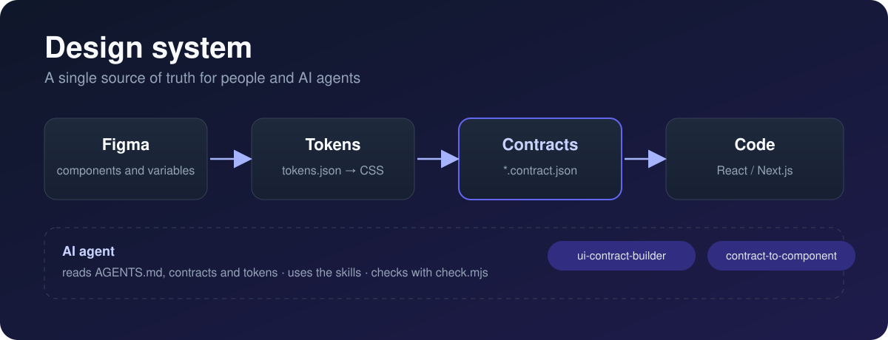

<p align="center">
  
</p>

<h1 align="center">Design system</h1>

<p align="center">
  <strong>The source of truth for your design system, in files that both people and AI agents can understand.</strong>
</p>

<p align="center">
  
  
  
  
  
  
  
  
  
</p>

---

## What it is

This repository stores, in versionable plain text, everything that defines your design system:

- **Tokens**: colors, spacing, typography and radii, with their modes (light and dark), exported from Figma.
- **Contracts**: one JSON per component that describes what it is for, which props, states, parts and tokens it uses, and how it must behave for accessibility.
- **Skills and rules for AI**: instructions that let an agent create contracts and components without inventing anything that is not in the contract.
- **Utilities**: scripts that generate the token CSS and the icon catalogs, and check that everything is consistent.

Figma and code **do not sync on their own**: both are checked against the same contract.

```
Figma (components + variables)
        │  you describe it once
        ▼
tokens/tokens.json  +  contracts/*.contract.json     ← this repo
        │  the agent reads them
        ▼
Code (Next.js: component.tsx + CSS + contract alongside)
```

## Main contents

| Part | What you will find |
| --- | --- |
| `tokens/` | Design variables. `tokens.json` is the only source; `tokens.css` is generated from it. |
| `contracts/` | Component contracts (Button, TextField, Navbar, Footer, Form, Icon…) and a template for new ones. |
| `skills/` | Two skills for agents: `ui-contract-builder` (creates contracts) and `contract-to-component` (implements the code and verifies it). |
| `icons/` | Registries of icons allowed in code, with Lucide and Phosphor alternatives. |
| `scripts/` | Generators for tokens, icons and catalogs. |
| `docs/` | Guides: how to write contracts, how to use Figma, Next.js, components and exercises. |
| `AGENTS.md` | Rules that any AI agent working with the system must follow. |

## Getting started

**Requirements:** [Node.js](https://nodejs.org/) to run the scripts. There are no dependencies to install for the check.

```bash
# Check contracts and tokens
node check.mjs

# Regenerate the CSS variables after changing tokens.json
npm run tokens:build
```

If this is your first time, do not open `Button.contract.json` (it is the longest). Start with **`contracts/Divider.contract.json`**, the shortest contract, and continue with `Link` and `Icon`.

## Workflow

1. **Prepare Figma**: variables by usage, auto layout and layers with stable names. Guide in `docs/figma.md`.
2. **Dump the tokens** into `tokens/` and run `npm run tokens:build`. Guide in `docs/tokens-from-figma.md`.
3. **Create the contract** from `contracts/_template.contract.json` or with the `ui-contract-builder` skill. Guide in `docs/contract-guide.md`.
4. **Implement the component** with the `contract-to-component` skill or by hand, following the contract.
5. **Check and save**: `node check.mjs`, add the component to `docs/components.md` and commit. If the component changes, **change the contract first** and its `version`.

## Skills and agents

Skills are reusable instructions that an AI agent loads when the task fits:

- **`ui-contract-builder`**: creates, updates and validates contracts from a Figma node or a mini-specification.
- **`contract-to-component`**: turns a contract into a React + TypeScript component and proves that it complies with what the contract says.

The agent reads `AGENTS.md` before touching any component, and does not fill gaps in the contract with assumptions: if something is not defined, it asks.

## Git

This repository is a starting point: you create the history.

```bash
git init -b main
git add .
git commit -m "Design system: contracts, tokens and skills"
```

To push it to GitHub, create an empty repository and follow the lines it shows you (`git remote add origin ...` and `git push -u origin main`). From then on, every contract change is a commit.

## The sample values

`tokens/tokens.json` ships the **Radix Themes** variables as they come out of Figma. If you work with your own Figma, replace them with yours following `docs/tokens-from-figma.md`. The sample contracts use Radix names, so you will need to adapt them.

## What it does not include (on purpose)

CI, Storybook and a documentation generator. They are added when needed.

## Documentation

| Document | What it is for |
| --- | --- |
| [`docs/contract-guide.md`](docs/contract-guide.md) | How a contract works and how to fill it in |
| [`docs/figma.md`](docs/figma.md) | Preparing Figma so the system fits |
| [`docs/components.md`](docs/components.md) | Component index and props vocabulary |
| [`docs/icons.md`](docs/icons.md) | Icons with Lucide: install, declare and use |
| [`docs/nextjs.md`](docs/nextjs.md) | Bringing the system into a Next.js project |
| [`docs/ejercicios.md`](docs/ejercicios.md) | Practical exercises |
